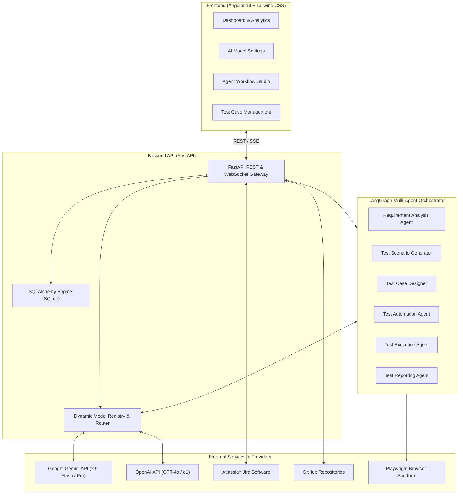

# AI Testing Assistant Platform

[](https://angular.dev/)
[](https://fastapi.tiangolo.com/)
[](https://www.python.org/)
[](https://playwright.dev/)
[](https://tailwindcss.com/)
[](https://www.sqlite.org/)
[](https://opensource.org/licenses/MIT)

An **autonomous, multi-agent AI testing system** built for enterprise QA engineers, SDETs, and software teams. The platform automates the end-to-end software quality lifecycle: from parsing Jira requirements and user stories to generating comprehensive boundary test scenarios, designing executable test cases, generating robust Playwright automation scripts, executing tests in sandboxed headless browsers, and generating executive audit-ready test reports.

---

## 📑 Table of Contents

- [Key Capabilities](#-key-capabilities)
- [System Architecture](#-system-architecture)
- [Multi-Agent Team](#-multi-agent-team)
- [Technology Stack](#-technology-stack)
- [Quick Start on a New PC](#-quick-start-on-a-new-pc)
  - [Prerequisites](#1-prerequisites)
  - [Step 1: Clone Repository](#step-1-clone-repository)
  - [Step 2: Backend Setup (FastAPI)](#step-2-backend-setup-fastapi)
  - [Step 3: Frontend Setup (Angular)](#step-3-frontend-setup-angular)
- [Configuring API Keys](#-configuring-api-keys)
  - [Method 1: Direct in Web Dashboard (Recommended)](#method-1-direct-in-web-dashboard-recommended)
  - [Method 2: In `.env` Configuration File](#method-2-in-env-configuration-file)
  - [Method 3: In System Environment Variables](#method-3-in-system-environment-variables)
- [Enterprise Integrations](#-enterprise-integrations)
  - [Jira Software Cloud](#jira-software-cloud)
  - [GitHub Repositories](#github-repositories)
- [Project Directory Structure](#-project-directory-structure)
- [Running Automated Tests](#-running-automated-tests)
- [Security & Data Isolation](#-security--data-isolation)
- [Contributing & License](#-contributing--license)

---

## 🌟 Key Capabilities

- **Modern Angular 19 UI**: Built with Angular standalone components, responsive collapsible navigation, dark/light theme switching, and real-time Apache ECharts analytics.
- **Independent Per-Agent Model Routing**: Assign different LLM models to each testing agent (e.g. Gemini 2.5 Flash for rapid scenario extraction, GPT-4o for complex locator automation, Gemini 2.5 Pro for deep reasoning).
- **Dynamic Model Discovery**: Fetches all available live endpoints dynamically from Google Gemini and OpenAI without hardcoded model lists.
- **100% Local Single-Tenant Isolation**: All projects, requirements, test cases, and agent execution checkpoints are stored permanently on your machine in an isolated SQLite database (`testing_platform.db`).
- **Resilient Playwright Automation**: Generates robust, maintainable Python Playwright automation code adhering to the Page Object Model (POM) pattern with resilient locator fallbacks.
- **Sandboxed Test Runner**: Executes test scripts in controlled headless/headed browser sessions, classifying test outcomes into Passed, Failed, Blocked, or Error with full stack traces.
- **Executive Audit Reports**: Generates consolidated coverage reports with one-click export to PDF and CSV formats.

---

## 🏗 System Architecture



---

## 🤖 Multi-Agent Team

| Agent | Responsibility | Recommended Model |
| :--- | :--- | :--- |
| **Requirement Analysis Agent** | Ingests PRDs, Jira user stories, or architecture files and extracts functional rules, non-functional criteria, and business constraints. | `gemini-2.5-flash` |
| **Test Scenario Generator** | Generates positive, negative, boundary, edge-case, and security test scenarios with high coverage. | `gemini-2.5-flash` |
| **Test Case Designer** | Converts scenarios into detailed, step-by-step executable test cases with preconditions, test inputs, and expected outcomes. | `gemini-2.5-flash` |
| **Test Automation Agent** | Generates robust, maintainable Python Playwright automation scripts implementing Page Object Model (POM) patterns. | `gpt-4o` / `gemini-2.5-pro` |
| **Test Execution Agent** | Executes test scripts in sandboxed browser sessions and performs root-cause failure analysis. | `gemini-2.5-flash` |
| **Test Reporting Agent** | Aggregates execution metrics, calculates pass/fail ratios, and produces executive markdown summaries. | `gemini-2.5-flash` |

---

## 💻 Technology Stack

### Frontend Client
- **Framework**: Angular 19 (Standalone Components, Signals, RxJS)
- **Styling**: Tailwind CSS 3.4 with custom enterprise dark mode palette
- **Charts & Data Visualization**: Apache ECharts
- **Icons**: Lucide SVG Architecture
- **Routing**: Angular Router with lazy-loaded routes

### Backend Server
- **Runtime**: Python 3.11+
- **API Framework**: FastAPI (Asynchronous REST endpoints)
- **Agent Orchestration**: LangGraph / LangChain StateGraph
- **LLM Abstraction**: LiteLLM & Native Google Generative AI SDK
- **Database ORM**: SQLAlchemy 2.0 with SQLite engine
- **Browser Automation**: Playwright Python Sandbox

---

## 🚀 Quick Start on a New PC

Follow these steps to set up and run the platform when cloning on a new computer:

### 1. Prerequisites
- **Git**: [git-scm.com](https://git-scm.com/)
- **Python**: Version `3.11` or higher ([python.org](https://www.python.org/downloads/))
- **Node.js**: Version `20.x` or `22.x` ([nodejs.org](https://nodejs.org/))

---

### Step 1: Clone Repository
```bash
git clone https://github.com/aryan25798/Testing_Agent.git
cd Testing_Agent
```

---

### Step 2: Backend Setup (FastAPI)

Open a terminal in the root directory:

1. **Create and activate a virtual environment**:
   - **Windows (PowerShell)**:
     ```powershell
     python -m venv .venv
     .\.venv\Scripts\Activate.ps1
     ```
   - **macOS / Linux**:
     ```bash
     python3 -m venv .venv
     source .venv/bin/activate
     ```

2. **Install Python dependencies**:
   ```bash
   pip install -r requirements.txt
   ```

3. **Install Playwright browser binaries**:
   ```bash
   playwright install chromium
   ```

4. **Initialize database & start the backend server**:
   ```bash
   python -m uvicorn src.main:app --host 127.0.0.1 --port 8000
   ```
   *The FastAPI server will be live at `http://127.0.0.1:8000` (API documentation available at `http://127.0.0.1:8000/docs`).*

---

### Step 3: Frontend Setup (Angular)

Open a **second terminal**:

1. **Navigate to the frontend folder**:
   ```bash
   cd frontend
   ```

2. **Install frontend dependencies**:
   ```bash
   npm install
   ```

3. **Start the Angular development server**:
   ```bash
   npx ng serve --port 4200
   ```

4. **Access the application**:
   Open **[http://localhost:4200](http://localhost:4200)** in your browser.

---

## 🔑 Configuring API Keys

You have **3 convenient ways** to configure your Google Gemini or OpenAI API keys:

### Method 1: Direct in Web Dashboard (Recommended & Easiest)
1. Open the web app at **[http://localhost:4200/models](http://localhost:4200/models)** (or click **AI Model Settings** in the left sidebar).
2. In the **Google Gemini** card, enter your key (`AQ...` or `AIza...`).
3. In the **OpenAI** card, enter your key (`sk-...`).
4. Click **Verify & Save Key**.
5. The application will immediately discover all available models dynamically and configure them for each agent.

---

### Method 2: In `.env` Configuration File
1. In the project root, copy `.env.example` to `.env`:
   ```bash
   # Windows PowerShell
   Copy-Item .env.example .env

   # macOS / Linux
   cp .env.example .env
   ```
2. Open `.env` and enter your keys:
   ```env
   GEMINI_API_KEY="your_gemini_api_key_here"
   OPENAI_API_KEY="your_openai_api_key_here"
   ```
3. Restart the FastAPI server. It will load the credentials automatically on boot.

---

### Method 3: In System Environment Variables
- **Windows (PowerShell)**:
  ```powershell
  $env:GEMINI_API_KEY="your_gemini_api_key_here"
  $env:OPENAI_API_KEY="your_openai_api_key_here"
  ```
- **macOS / Linux**:
  ```bash
  export GEMINI_API_KEY="your_gemini_api_key_here"
  export OPENAI_API_KEY="your_openai_api_key_here"
  ```

---

## 🔌 Enterprise Integrations

Navigate to **[http://localhost:4200/settings](http://localhost:4200/settings)** to connect external developer tools:

### Jira Software Cloud
- **Host URL**: e.g. `https://your-domain.atlassian.net`
- **Email**: Atlassian account email
- **API Token**: Generated from [id.atlassian.com/manage-profile/security/api-tokens](https://id.atlassian.com/manage-profile/security/api-tokens)
- **Features**: Live user story extraction, acceptance criteria parsing, and sprint issue synchronization.

### GitHub Repositories
- **Personal Access Token (PAT)**: Generated with `repo` read/write permissions.
- **Repository Full Name**: e.g. `organization/repository`
- **Features**: Inspects application source code, maps existing Page Objects, and aligns generated Playwright selectors with real DOM elements.

---

## 📁 Project Directory Structure

```text
Testing_Agent/
├── .env.example                     # Environment template
├── .gitignore                       # Git ignore rules (secrets & builds excluded)
├── README.md                        # Master documentation
├── requirements.txt                 # Python production dependencies
├── requirements-dev.txt             # Development & testing dependencies
├── frontend/                        # Angular 19 Standalone Frontend
│   ├── angular.json                 # Angular CLI configuration
│   ├── package.json                 # Node dependencies
│   ├── tailwind.config.js           # Tailwind CSS configuration & tokens
│   ├── src/
│   │   ├── app/
│   │   │   ├── core/
│   │   │   │   ├── models/types.ts  # TypeScript domain contracts
│   │   │   │   └── services/        # ApiService, ThemeService, SidebarService
│   │   │   ├── layout/
│   │   │   │   ├── header/          # Sticky header, search, theme switcher
│   │   │   │   └── sidebar/         # Responsive collapsible navigation
│   │   │   ├── pages/               # Dashboard, Projects, Agents, Workflows,
│   │   │   │                        # Test Cases, Automation, Executions, Reports,
│   │   │   │                        # Model Settings, Settings
│   │   │   └── shared/components/   # Lucide IconComponent & UI helpers
│   │   ├── index.html
│   │   ├── main.ts
│   │   └── styles.css
│   └── public/
│       ├── favicon.ico
│       └── qa_robot_assistant.jpg   # 3D QA mascot visual asset
├── src/                             # Python Backend Application
│   ├── main.py                      # FastAPI entry point & CORS configuration
│   ├── agents/                      # 6 Core LangGraph Testing Agents
│   ├── api/                         # REST Endpoints (Dashboard, Projects, Models, etc.)
│   ├── config/                      # Settings & environment configuration
│   ├── database/                    # SQLAlchemy database engine & sessions
│   ├── integrations/                # Jira, GitHub, and file parsers
│   ├── llm/                         # Dynamic provider abstraction & model routing
│   ├── models/                      # SQLAlchemy database entities
│   ├── schemas/                     # Pydantic v2 validation models
│   └── workflows/                   # LangGraph workflow graphs & state management
└── tests/                           # Unit, integration, and E2E test suites
    ├── unit/
    ├── integration/
    └── e2e/
```

---

## 🧪 Running Automated Tests

Run the backend unit and integration test suites:

```powershell
# Run all unit tests
pytest tests/unit/ -v

# Run with test coverage report
pytest --cov=src tests/unit/
```

Test Angular frontend compilation:

```powershell
cd frontend
npm run build
```

---

## 🛡 Security & Data Isolation

- **Single-Tenant Workspace**: Runs entirely on your local machine (`127.0.0.1`).
- **No Telemetry or Leaked Data**: Your test data, Jira stories, and application code are stored strictly in local SQLite storage.
- **Git Safety**: Credentials, `.env` files, `.venv`, virtual environments, and SQLite database binaries are strictly ignored in `.gitignore` to prevent accidental credential leakage.

---

## 📄 License & Attribution

Distributed under the **MIT License**. Created by **Aryan** for Cognizant QA Engineering & Autonomous Testing Operations.
