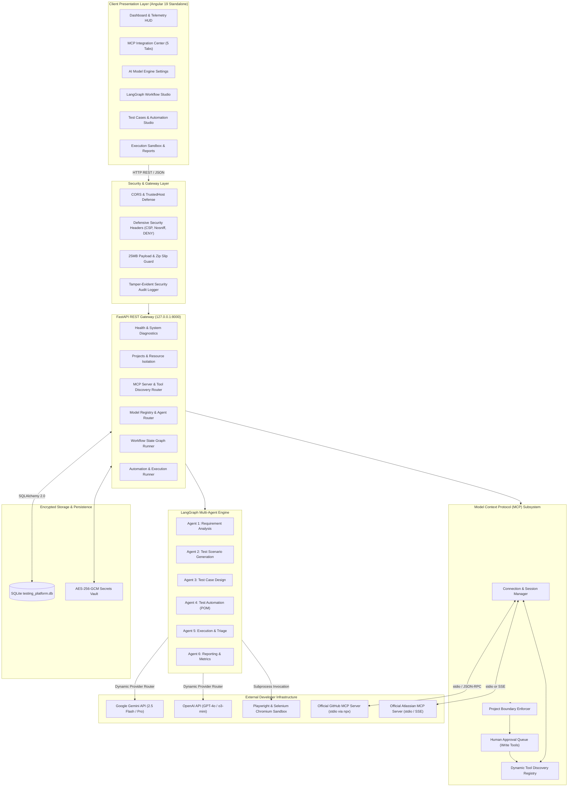
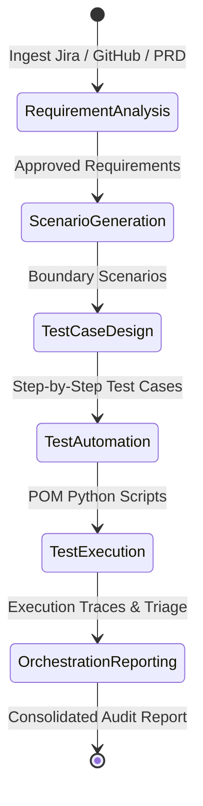
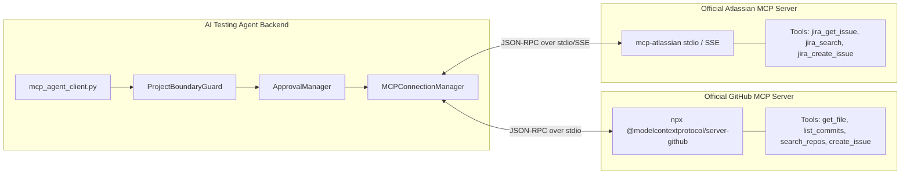
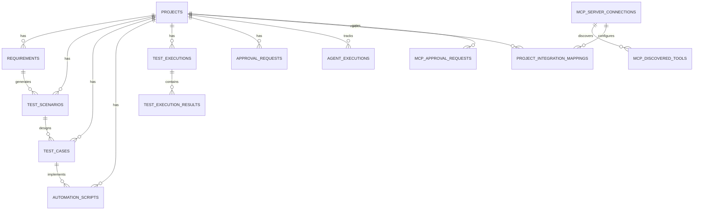

# AI Testing Agent: Autonomous Multi-Agent Software Quality Engineering Platform

[](https://angular.dev/)
[](https://fastapi.tiangolo.com/)
[](https://www.python.org/)
[](https://playwright.dev/)
[](https://www.selenium.dev/)
[](https://modelcontextprotocol.io/)
[](https://www.langchain.com/langgraph)
[](https://www.sqlite.org/)
[](https://opensource.org/licenses/MIT)

> **AI Testing Agent** is an enterprise-grade, autonomous multi-agent quality engineering system designed for SDETs, QA Automation Leads, and engineering teams. Powered by **LangGraph**, **FastAPI**, **Angular 19**, and the **Model Context Protocol (MCP)**, the platform coordinates six specialized autonomous agents to ingest Jira/GitHub specifications, synthesize boundary test scenarios, design executable test cases, generate Page Object Model (POM) automation scripts, execute tests in sandboxed headless browsers, and enforce human-in-the-loop quality gates.

---

## Table of Contents

1. [Project Overview](#1-project-overview)
2. [Problem Statement & Industry Context](#2-problem-statement--industry-context)
3. [Implemented Features and Capabilities](#3-implemented-features-and-capabilities)
4. [Technology Stack](#4-technology-stack)
5. [System Architecture](#5-system-architecture)
6. [Complete Repository Directory Structure](#6-complete-repository-directory-structure)
7. [System Requirements and Prerequisites](#7-system-requirements-and-prerequisites)
8. [Complete Step-by-Step Installation Guide](#8-complete-step-by-step-installation-guide)
9. [Application Usage Guide](#9-complete-application-usage-guide)
10. [AI Agents and LangGraph Workflow Engine](#10-ai-agents-and-langgraph-workflow-engine)
11. [Model Context Protocol (MCP) Integration](#11-model-context-protocol-mcp-integration)
12. [Database Architecture and Data Persistence](#12-database-architecture-and-data-persistence)
13. [Security Architecture and Cryptographic Controls](#13-security-architecture-and-cryptographic-controls)
14. [Complete REST API Documentation](#14-complete-rest-api-documentation)
15. [Testing, Quality Checks, and Build Validation](#15-testing-quality-checks-and-build-validation)
16. [Troubleshooting Guide](#16-troubleshooting-guide)
17. [Configuration Reference](#17-configuration-reference)
18. [Development and Contribution Workflow](#18-development-and-contribution-workflow)
19. [Known Limitations and Roadmap](#19-known-limitations-and-roadmap)
20. [Frequently Asked Questions (FAQ)](#20-frequently-asked-questions-faq)
21. [License and Attribution](#21-license-and-attribution)

---

## 1. Project Overview

### What is AI Testing Agent?
**AI Testing Agent** is a full-stack, local-first testing orchestration platform. Unlike conventional test management tools or static automation scripts, this application models the complete cognitive workflow of a human QA engineering team using a stateful directed acyclic graph (DAG) managed by **LangGraph**.

The platform is purpose-built to eliminate repetitive manual work across all phases of software verification:
- **Understanding**: Ingesting business requirements and acceptance criteria directly from Jira stories, GitHub repositories, or PRD documents.
- **Synthesizing**: Discovering functional boundaries, equivalence classes, and security edge cases.
- **Designing**: Creating step-by-step test cases with structured synthetic test data.
- **Automating**: Generating production-grade **Playwright** and **Selenium** Python code adhering to the Page Object Model (POM) pattern.
- **Executing**: Running browser tests inside an isolated execution sandbox and classifying root-cause failures.
- **Reporting**: Compiling executive-level quality audit reports with coverage metrics and failure triaging.

### Who is this Platform Built For?
- **SDETs and QA Engineers**: Accelerate automation authoring from hours to seconds while maintaining strict code quality and locator resilience.
- **QA Leads and Engineering Managers**: Enforce company-wide test coverage standards, boundary conditions, and human approval gates before executing mutating actions.
- **Full-Stack Developers**: Generate comprehensive regression suites directly from Jira issues before shipping features.
- **Security-Conscious Organizations**: Run autonomous AI agents in a **100% private, single-tenant, local workspace** where code, Jira tickets, and API keys are encrypted at rest with hardware-accelerated **AES-256-GCM** and never leaked to external telemetry.

---

## 2. Problem Statement & Industry Context

Traditional test automation faces persistent industry bottlenecks:

| Dimension | Traditional Manual & Scripted QA | Generic AI Chatbots (ChatGPT / Claude) | AI Testing Agent Platform |
| :--- | :--- | :--- | :--- |
| **Requirements Context** | Manual review of Jira tickets; ambiguous rules frequently missed. | User must copy/paste code snippets into a browser chat window. | **Official MCP Clients** connect directly to GitHub and Jira with project boundary enforcement. |
| **Scenario Coverage** | Heavy reliance on happy paths; edge cases and boundary limits omitted. | Chatbot produces unstructured bullets without data validation. | **Systematic Boundary Analysis** generates positive, negative, equivalence, and security scenarios. |
| **Code Maintainability** | Brittle inline selectors (XPath/CSS) that break on minor DOM alterations. | Non-executable code snippets lacking fixtures or configuration. | Generates structured **Page Object Model (POM)** with resilient locator fallbacks. |
| **Execution Loop** | Manual execution or rigid CI runs with zero automated triage. | Cannot execute code or capture screenshots independently. | **Subprocess Sandbox** executes tests, captures traces/logs, and performs AI failure classification. |
| **Governance & Safety** | Changes committed directly; no audit trail of AI modifications. | Direct execution risks unintentional data modification or deletion. | **Human-in-the-Loop (HITL) Queue**: Mutating actions require explicit developer approval. |
| **Data Privacy** | SaaS tools store proprietary tickets and credentials in multi-tenant cloud DBs. | Prompts may be logged or used for model retraining. | **Local AES-256-GCM Vault**: Credentials encrypted at rest; zero-token browser storage. |

---

## 3. Implemented Features and Capabilities

All capabilities listed below are **fully implemented and verified** in the codebase:

```
+--------------------------------------------------------------------------------------------------+
|                                    PLATFORM CAPABILITIES OVERVIEW                                |
+-------------------------------+----------------------------------+-------------------------------+
| Planning & Ingestion          | Automation & Execution           | Governance & Infrastructure   |
+-------------------------------+----------------------------------+-------------------------------+
| • Jira Story Parsing (MCP)    | • Playwright Script Generation   | • Model Context Protocol (MCP)|
| • GitHub Code Reading (MCP)   | • Selenium WebDriver Support     | • Dynamic Model Discovery     |
| • PRD File Extraction         | • Page Object Model (POM) Struct | • Per-Agent Model Routing     |
| • Boundary Scenario Synthesis | • Subprocess Execution Sandbox   | • Human Approval Queue (HITL) |
| • Step-by-Step Test Design    | • Automated Root-Cause Triage    | • Hardware AES-256-GCM Vault  |
| • Synthetic Test Data Gen     | • Executive Audit Metrics (CSV)  | • Single-Tenant SQLite DB     |
+-------------------------------+----------------------------------+-------------------------------+
```

### Detailed Feature Breakdown

#### 1. Project Management & Framework Isolation
- **What it does**: Allows users to manage multiple software testing initiatives, choosing between **Playwright** and **Selenium** as the target execution framework.
- **Why it is useful**: Ensures clean isolation between distinct software repositories, applications, and target environments.
- **Access**: Navigate to `/projects` or click **My Projects** in the sidebar.
- **Internal Mechanism**: Backed by the `projects` table in SQLite; cascades delete operations cleanly to requirements, scenarios, test cases, scripts, and execution records.

#### 2. Model Context Protocol (MCP) Integration Center
- **What it does**: Connects the AI Testing Agent to external developer systems using the official **Model Context Protocol (MCP)** specification.
  - **GitHub MCP**: Connects via official stdio subprocess (`@modelcontextprotocol/server-github`) to inspect codebases, read files, list branches, and query pull requests.
  - **Atlassian Jira MCP**: Connects via official stdio or remote SSE (`mcp.atlassian.com/v2/mcp`) to retrieve user stories, acceptance criteria, and issues.
- **Why it is useful**: Replaces brittle direct REST API integrations with dynamic capability negotiation, real tool schema discovery, and strict project boundary controls.
- **Access**: Navigate to `/integrations` or click **MCP Integrations** in the sidebar.
- **Tabs**:
  1. *MCP Server Connections*: Live connection wizards, protocol negotiation, and read-only enforcement.
  2. *Project Resource Mapping*: Enforces that agents only query approved repositories and Jira project keys.
  3. *Discovered Tools*: Dynamic schema viewer for all 14+ negotiated tools with risk levels and permitted agent roles.
  4. *Approval Queue*: Human-in-the-loop review queue for write operations (`create_issue`, `push_files`).
  5. *Audit Log*: Immutable log of every tool execution, actor, parameters, latency, and status.

#### 3. AI Model Engine & Independent Per-Agent Model Router
- **What it does**: Supports both **Google Gemini** (Gemini 2.5 Flash, Gemini 2.5 Pro) and **OpenAI** (GPT-4o, GPT-4o-mini, o1, o3-mini) with independent model assignment per agent.
- **Why it is useful**: Optimizes cost, speed, and cognitive power. Use ultra-fast Flash models for initial requirement parsing, and switch to GPT-4o or Gemini 2.5 Pro for complex locator generation and root-cause debugging.
- **Access**: Navigate to `/models` or click **AI Model Settings** in the sidebar.
- **Internal Mechanism**: Dynamic model discovery queries configured providers at runtime via LiteLLM and native SDKs without hardcoded limitations. Credentials are encrypted in the local vault.

#### 4. Multi-Agent Workflow Studio
- **What it does**: Visualizes and runs the full 6-agent testing pipeline as a stateful LangGraph state machine.
- **Why it is useful**: Automates the journey from raw requirements to finished execution and reporting in a single unified flow.
- **Access**: Navigate to `/workflows` or click **Workflows** in the sidebar.
- **Internal Mechanism**: State transitions are managed by `TestingWorkflowState` passing typed inputs and outputs between agents.

#### 5. Test Case Design & Automation Generation
- **What it does**: Translates test scenarios into step-by-step test cases (preconditions, execution actions, expected assertions, test data) and generates syntactically valid Python automation scripts.
- **Why it is useful**: Eliminates manual test script authoring and enforces standard design patterns (fixtures, `conftest.py`, base pages, assertions).
- **Access**: Navigate to `/test-cases` and `/automation`.

#### 6. Sandboxed Test Execution Engine
- **What it does**: Executes generated Playwright and Selenium test scripts inside an isolated local subprocess environment.
- **Why it is useful**: Validates that scripts actually run against the target URL, capturing execution duration, stack traces, console logs, and failure triage classifications (*ApplicationDefect*, *EnvironmentIssue*, or *FlakyTest*).
- **Access**: Navigate to `/executions`.

---

## 4. Technology Stack

### Technology Architecture Matrix

| Layer | Technology | Version | Purpose in Application | Communication & Integration |
| :--- | :--- | :--- | :--- | :--- |
| **Frontend Framework** | **Angular** | `19.2.0` | Enterprise SPA client with standalone components and reactive architecture. | Communicates with FastAPI via asynchronous REST HTTP (`HttpClient` with RxJS). |
| **Styling & Design** | **Tailwind CSS** | `3.4.19` | High-density enterprise dark/light theme styling with custom design tokens. | PostCSS pipeline bundled into Angular styles. |
| **Iconography** | **Lucide Icons** | Custom Vector | Unified 24×24 SVG icon architecture with zero external font dependencies. | Embedded directly into `IconComponent` with Simple Icons brand paths. |
| **Analytics Charts** | **Apache ECharts** | `6.1.0` | Real-time pass/fail distribution, coverage gauges, and trend analytics. | Initialized in Dashboard and Reports components. |
| **Backend Runtime** | **Python** | `3.11` – `3.14` | High-performance asynchronous backend execution runtime. | Subprocess management and async event loops. |
| **Backend Framework** | **FastAPI** | `0.115.0+` | High-speed async REST API gateway with OpenAPI/Swagger auto-generation. | ASGI server running under Uvicorn on port 8000. |
| **ASGI Server** | **Uvicorn** | `0.34.0+` | Asynchronous server implementation for FastAPI. | Listens on `127.0.0.1:8000`. |
| **Agent Orchestrator**| **LangGraph** | `1.2.23+` | Stateful multi-agent graph orchestration modeling the QA lifecycle. | Orchestrates agent nodes and transitions via `StateGraph`. |
| **LLM Gateway** | **LiteLLM / SDKs** | Native | Unified abstraction layer supporting Google Gemini and OpenAI models. | Dynamic model discovery and per-agent routing. |
| **Relational Database**| **SQLite 3** | Embedded | Zero-configuration, single-tenant relational storage (`testing_platform.db`). | SQLAlchemy 2.0 ORM engine with foreign key cascades. |
| **Security & Secrets**| **AES-256-GCM** | Native | Hardware-accelerated authenticated encryption for tokens and API keys. | `secrets_vault.py` managing zero-token browser storage. |
| **MCP Client** | **MCP Python SDK** | `1.2.0+` | Official Model Context Protocol client implementation. | Stdio subprocesses (`npx`) and remote SSE clients. |
| **Browser Automation**| **Playwright** | `1.40.0+` | Fast, headless Chromium browser automation with trace and console capture. | Python `sync_api` invoked inside execution sandbox. |
| **Browser Automation**| **Selenium** | `4.27.0+` | Cross-browser WebDriver automation engine for enterprise Selenium targets. | Python `selenium.webdriver` invoked inside execution sandbox. |

---

## 5. System Architecture



### Communication Flow: End-to-End Execution
1. **Specification Ingestion**: The user maps a GitHub repository (`owner/repo`) or Jira project (`KEY`) via the **MCP Integration Center**.
2. **Dynamic Tool Negotiation**: The backend launches the official MCP server subprocess (`@modelcontextprotocol/server-github` via stdio), negotiates protocol capabilities, and discovers available tools.
3. **Requirement Extraction**: Agent 1 invokes MCP read-only tools to extract functional specifications and acceptance criteria.
4. **Scenario & Test Case Generation**: Agent 2 creates boundary test scenarios; Agent 3 converts scenarios into structured test cases with synthetic test data.
5. **Automation Script Generation**: Agent 4 writes complete Page Object Model test scripts targeting either Playwright or Selenium.
6. **Execution & Failure Classification**: Agent 5 executes tests inside the local headless sandbox and classifies failures.
7. **Consolidated Reporting**: Agent 6 compiles executive metrics and outputs reports to CSV and Markdown.

---

## 6. Complete Repository Directory Structure

```text
testing-agent-platform/
│
├── .env.example                     # Environment configuration template
├── .gitignore                       # Git ignore definitions (secrets, DBs, venvs)
├── README.md                        # Master project documentation
├── requirements.txt                 # Production Python dependencies
├── requirements-dev.txt             # Testing and development dependencies (pytest)
├── testing_platform.db              # Local SQLite database (auto-created on first run)
│
├── frontend/                        # Angular 19 Standalone Frontend Application
│   ├── angular.json                 # Angular build and project configuration
│   ├── package.json                 # Node dependencies and npm scripts
│   ├── tsconfig.json                # TypeScript compiler configuration
│   ├── tsconfig.app.json            # Application-specific TypeScript rules
│   ├── tailwind.config.js           # Tailwind CSS theme tokens and dark mode config
│   │
│   ├── public/                      # Static web assets
│   │   ├── favicon.svg              # Precision Quality Gate browser favicon
│   │   ├── logo.svg                 # Precision Quality Gate brand mark
│   │   └── favicon.ico              # Legacy favicon fallback
│   │
│   └── src/
│       ├── index.html               # Main HTML entry point
│       ├── main.ts                  # Angular bootstrap file
│       ├── styles.css               # Global styles, Tailwind directives, custom scrollbars
│       │
│       └── app/
│           ├── app.component.ts     # Root shell component (Header + Sidebar + RouterOutlet)
│           ├── app.routes.ts        # 11 lazy-loaded application routes
│           │
│           ├── core/                # Core enterprise services and domain models
│           │   ├── models/
│           │   │   └── types.ts     # TypeScript contracts (Project, TestCase, MCPDTOs)
│           │   └── services/
│           │       ├── api.service.ts      # Unified backend HTTP API service
│           │       ├── sidebar.service.ts  # Sidebar collapse and mobile drawer state
│           │       └── theme.service.ts    # Dark/light mode theme management
│           │
│           ├── layout/              # Shared application layout components
│           │   ├── header/          # Sticky navbar, command palette trigger, theme switch
│           │   └── sidebar/         # Collapsible navigation, engine status, profile card
│           │
│           ├── pages/               # Feature-specific page components
│           │   ├── dashboard/       # Dashboard with Autonomous Telemetry HUD & analytics
│           │   ├── projects/        # Project management, creation, and framework toggle
│           │   ├── agents/          # Predefined core agents and custom QA agent studio
│           │   ├── workflows/       # LangGraph multi-agent execution studio
│           │   ├── test-cases/      # Test case designer, test data, and assertion matrix
│           │   ├── automation/      # Automation script generator and code viewer
│           │   ├── executions/      # Sandboxed test execution runner and failure logs
│           │   ├── reports/         # Executive QA metrics and CSV/PDF export
│           │   ├── model-settings/  # Gemini/OpenAI API management & per-agent routing
│           │   ├── integrations/    # MCP Integration Center (Connections, Mappings, Tools)
│           │   └── settings/        # System diagnostics, database health, security policy
│           │
│           └── shared/              # Reusable UI components
│               └── components/
│                   ├── icon.component.ts          # Centralized Lucide SVG & brand icon system
│                   ├── logo.component.ts          # Quality Gate vector emblem and wordmark
│                   └── global-search.component.ts # Command palette modal (Cmd+K / Ctrl+K)
│
├── src/                             # Python FastAPI Backend Application
│   ├── main.py                      # Application bootstrap, CORS, CSP, security middleware
│   │
│   ├── agents/                      # 6 Core LangGraph AI Testing Agents
│   │   ├── base/base_agent.py       # Abstract base agent with model routing and telemetry
│   │   ├── requirement_analysis/    # Agent 1: Ingests specifications from MCP / files
│   │   ├── scenario_generation/     # Agent 2: Synthesizes boundary and edge scenarios
│   │   ├── test_case_design/        # Agent 3: Designs structured test cases and data
│   │   ├── test_automation/         # Agent 4: Generates Playwright/Selenium POM scripts
│   │   ├── test_execution/          # Agent 5: Executes tests in sandbox and triages failures
│   │   └── orchestration_reporting/ # Agent 6: Compiles consolidated audit metrics
│   │
│   ├── api/                         # FastAPI REST Endpoints
│   │   ├── health.py                # Health checks and system diagnostic endpoints
│   │   ├── projects.py              # Project CRUD operations
│   │   ├── requirements.py          # Requirement management endpoints
│   │   ├── scenarios.py             # Test scenario endpoints
│   │   ├── test_cases.py            # Test case creation and approval endpoints
│   │   ├── automation.py            # Script generation and syntax validation
│   │   ├── executions.py            # Test execution runner endpoints
│   │   ├── approvals.py             # Human-in-the-loop approval endpoints
│   │   ├── models_api.py            # Dynamic model discovery & per-agent configuration
│   │   ├── integrations_api.py      # Legacy integration bridge endpoints
│   │   ├── workflows_api.py         # LangGraph workflow initiation and status
│   │   ├── dashboard_api.py         # Aggregated telemetry statistics
│   │   ├── custom_agents_api.py     # Custom specialized QA agent CRUD
│   │   └── mcp_api.py               # Model Context Protocol (MCP) Integration Endpoints
│   │
│   ├── config/                      # Configuration and environment management
│   │   └── settings.py              # Pydantic v2 settings loading from .env
│   │
│   ├── core/                        # Core infrastructural components
│   │   ├── exceptions.py            # Custom platform exception hierarchy
│   │   ├── logging.py               # Structured logging configuration
│   │   └── security/                # Security subsystem
│   │       ├── audit_logger.py      # Tamper-evident JSON audit logging
│   │       ├── sanitizer.py         # Prompt injection defense & secret redaction
│   │       └── secrets_manager.py   # AES-256-GCM hardware vault for credentials
│   │
│   ├── database/                    # SQLAlchemy database engine
│   │   └── session.py               # Database engine, session maker, schema initializer
│   │
│   ├── integrations/                # External integration clients
│   │   ├── files/parser.py          # PDF, DOCX, TXT requirement document extraction
│   │   ├── git/git_client.py        # Local Git utility wrapper
│   │   ├── jira/jira_client.py      # Jira direct bridge (fallback)
│   │   └── mcp/                     # Official Model Context Protocol (MCP) Subsystem
│   │       ├── connection_manager.py # Stdio/SSE subprocess manager & protocol negotiation
│   │       ├── tool_registry.py     # Dynamic tool catalog with schema enforcement
│   │       ├── approval_manager.py  # Human approval gating for mutating tools
│   │       ├── mcp_agent_client.py  # Boundary-enforced client used by AI agents
│   │       └── models.py            # MCP DTO contracts and Pydantic request models
│   │
│   ├── llm/                         # LLM Provider Abstraction & Model Routing
│   │   ├── capabilities/models.py   # Known model context windows and token pricing
│   │   ├── providers/               # Base and vendor-specific LLM adapters
│   │   │   ├── base.py              # Abstract LLM provider contract
│   │   │   ├── gemini_provider.py   # Google Gemini SDK adapter
│   │   │   └── openai_provider.py   # OpenAI SDK adapter
│   │   ├── registry/model_registry.py # Dynamic live endpoint discovery engine
│   │   └── router/agent_model_router.py # Per-agent model assignment and routing
│   │
│   ├── models/
│   │   └── entities.py              # SQLAlchemy database ORM entities
│   │
│   ├── schemas/                     # Pydantic validation schemas
│   │
│   └── workflows/                   # LangGraph Multi-Agent Workflow Engine
│       ├── graph.py                 # 6-Node StateGraph definition and compilation
│       └── state.py                 # TypedDict TestingWorkflowState definition
│
└── tests/                           # Pytest Test Automation Suite (33 verified tests)
    ├── unit/                        # Unit tests for agents and model routers
    ├── integration/                 # Integration tests for REST APIs and MCP workflows
    ├── security/                    # Security hardening, secrets vault, and injection tests
    └── e2e/                         # End-to-end 6-agent workflow integration tests
```

---

## 7. System Requirements and Prerequisites

### Minimum System Specifications
- **Operating System**: Windows 10/11, macOS 12+ (Monterey or later), or Ubuntu 22.04+ LTS.
- **CPU**: Dual-core processor minimum (Quad-core recommended for local test execution).
- **RAM**: 8 GB minimum (16 GB recommended when running headless browser sessions).
- **Disk Space**: 2 GB free disk space for dependencies, virtual environments, and Playwright browsers.

### Software Prerequisites

Verify your installed software versions using the terminal commands below:

| Requirement | Supported Version | Windows (PowerShell) Check | Linux / macOS Check |
| :--- | :--- | :--- | :--- |
| **Git** | `2.30+` | `git --version` | `git --version` |
| **Python** | `3.11` to `3.14` | `python --version` | `python3 --version` |
| **Node.js** | `20.x` or `22.x` (LTS) | `node -v` | `node -v` |
| **npm** | `10.x+` | `npm -v` | `npm -v` |
| **Google Chrome / Chromium** | Latest Stable | `Get-Item "C:\Program Files\Google\Chrome\Application\chrome.exe"` | `google-chrome --version` |

> [!NOTE]
> Node.js (`npx`) is required to run the official GitHub MCP server subprocess (`@modelcontextprotocol/server-github`). Ensure `npx` is available on your system `PATH`.

---

## 8. Complete Step-by-Step Installation Guide

Follow these exact steps to set up and run the application from a clean repository clone.

### Step 1: Clone the Repository
Open a terminal and clone the repository:

```bash
git clone https://github.com/aryan25798/Testing_Agent.git
cd Testing_Agent
```

If you cloned into a folder containing `testing-agent-platform`, navigate into it:
```bash
cd testing-agent-platform
```

---

### Step 2: Set Up the Backend Python Environment

Always use a dedicated virtual environment to prevent package conflicts with your system Python:

#### Windows (PowerShell):
```powershell
# Create the virtual environment
python -m venv .venv

# Activate the virtual environment
.\.venv\Scripts\Activate.ps1
```

> [!TIP]
> If PowerShell throws an execution policy error (`Execution of scripts is disabled on this system`), run:
> `Set-ExecutionPolicy -ExecutionPolicy RemoteSigned -Scope CurrentUser`

#### Linux / macOS (Bash):
```bash
# Create the virtual environment
python3 -m venv .venv

# Activate the virtual environment
source .venv/bin/activate
```

---

### Step 3: Install Backend Dependencies

With your virtual environment activated, install all required dependencies:

```bash
pip install --upgrade pip
pip install -r requirements.txt
pip install -r requirements-dev.txt
```

#### Install Playwright Browser Binaries
Playwright requires headless Chromium binaries to execute browser test scripts:

```bash
playwright install chromium
```

---

### Step 4: Configure Backend Environment Variables

1. Copy the provided `.env.example` file to create your local `.env`:

   **Windows (PowerShell)**:
   ```powershell
   Copy-Item .env.example .env
   ```

   **Linux / macOS (Bash)**:
   ```bash
   cp .env.example .env
   ```

2. Open `.env` in your text editor. Inspect the configuration options below:

| Environment Variable | Required? | Default / Example Value | Description |
| :--- | :--- | :--- | :--- |
| `ENVIRONMENT` | Optional | `development` | Runtime mode (`development` or `production`). |
| `DEBUG` | Optional | `True` | Enables debug logging and interactive Swagger docs. |
| `LOG_LEVEL` | Optional | `INFO` | Logging threshold (`DEBUG`, `INFO`, `WARNING`, `ERROR`). |
| `APP_HOST` | Optional | `127.0.0.1` | Local IP address for the FastAPI backend server. |
| `APP_PORT` | Optional | `8000` | Port for the FastAPI backend server. |
| `FRONTEND_URL` | Optional | `http://localhost:4200` | Allowed origin for Cross-Origin Resource Sharing (CORS). |
| `SECRET_KEY` | Recommended | `dev_secret_key_testing_agent_platform_2026_local` | Master key for local session protection and token signing. |
| `DATABASE_URL` | Optional | `sqlite:///./testing_platform.db` | SQLAlchemy connection string pointing to local SQLite file. |
| `GEMINI_API_KEY` | Optional* | `AIzaSy...` | API key for Google Gemini (`gemini-2.5-flash`, `gemini-2.5-pro`). |
| `OPENAI_API_KEY` | Optional* | `sk-proj-...` | API key for OpenAI (`gpt-4o`, `gpt-4o-mini`, `o1`). |

*\* Note: API keys can either be defined in `.env` OR entered directly through the web UI at `http://localhost:4200/models` with zero-token browser storage.*

---

### Step 5: Configure and Build the Frontend

Open a **second terminal** and navigate to the `frontend/` directory:

```bash
cd frontend
```

1. **Install Node.js dependencies**:
   ```bash
   npm install
   ```

2. **Verify Angular build**:
   ```bash
   npm run build
   ```
   *Expected output: Application bundle generation complete with 0 errors.*

---

### Step 6: Database Initialization

The application uses an embedded **SQLite** database (`testing_platform.db`).
- **No manual migrations are required**: On backend startup, `src.database.session.init_db()` executes automatically, creating all required relational tables, indexes, and default MCP server connection entries.
- **Persistence**: All data persists in `testing-agent-platform/testing_platform.db`. Restarting the backend server does **not** wipe existing test cases or configurations.

---

### Step 7: Start the Application

You will run the backend and frontend servers in two separate terminal windows:

#### Terminal 1: Backend Server (FastAPI)
In `testing-agent-platform/` with `.venv` activated:

```bash
python -m uvicorn src.main:app --host 127.0.0.1 --port 8000 --reload
```

- **Backend URL**: `http://127.0.0.1:8000`
- **Swagger Documentation**: `http://127.0.0.1:8000/docs`
- **Health Check**: `http://127.0.0.1:8000/api/v1/health`

#### Terminal 2: Frontend Server (Angular)
In `testing-agent-platform/frontend/`:

```bash
npm start
```
*(or `npx ng serve --port 4200`)*

- **Frontend Application URL**: `http://localhost:4200`

---

### Step 8: Verify Successful Installation

Open **`http://localhost:4200`** in Google Chrome. Verify the following:
1. The **AI Testing Agent** dashboard loads with the custom Quality Gate logo in the upper left corner.
2. The **Autonomous Quality Engine Telemetry** card shows `ENGINE LIVE` and `LangGraph 6-Node Active`.
3. The bottom-left status indicator displays `Engine Active (FastAPI & Playwright Ready)` with an active green pulse.
4. Open `http://127.0.0.1:8000/api/v1/health` in your browser. It should return:
   ```json
   {
     "status": "healthy",
     "app_name": "TestingAgentPlatform",
     "version": "1.0.0",
     "environment": "development",
     "database_connected": true,
     "default_provider": "gemini"
   }
   ```

---

## 9. Complete Application Usage Guide

Follow this step-by-step user journey to run your first autonomous test automation cycle:

```
+----------------------------------------------------------------------------------------------------+
|                                      END-TO-END QA USER JOURNEY                                     |
+---------------------+-----------------------+------------------------+-----------------------------+
| 1. Connect Models   | 2. Connect MCP        | 3. Create Project      | 4. Run LangGraph Workflow   |
| • Enter Gemini Key  | • Connect GitHub MCP  | • Select Framework     | • Requirements -> Scenarios |
| • Enter OpenAI Key  | • Connect Jira MCP    | • Map Repos & Jira Keys| • Test Cases -> POM Scripts |
| • Assign Per Agent  | • Verify Discovered   | • Define Target URL    | • Sandboxed Execution       |
+---------------------+-----------------------+------------------------+-----------------------------+
```

### 1. Configure AI Provider Credentials
1. Navigate to **AI Model Settings** (`/models`).
2. Enter your **Google Gemini API Key** (starts with `AIzaSy...`) or **OpenAI API Key** (starts with `sk-...`).
3. Click **Verify & Save Key**.
4. The system validates the key against live provider endpoints, discovers all available models, and saves the credentials encrypted in your local vault.
5. In the **Independent Per-Agent Model Assignment** section, choose which model powers each of the 6 testing agents (e.g., set Agent 4 to `gpt-4o-mini` and Agent 1 to `gemini-2.5-flash`).

### 2. Connect Developer Tools via MCP
1. Navigate to **MCP Integrations** (`/integrations`).
2. In the **Official GitHub MCP Server** card, click **Connect GitHub MCP**. Enter your GitHub Personal Access Token (PAT with `repo` scope).
3. In the **Official Atlassian MCP Server** card, enter your Jira Host URL (`https://your-domain.atlassian.net`), email, and API token. Click **Connect Atlassian MCP**.
4. Click the **Discovered Tools** tab to inspect all 14+ dynamically negotiated tools (`github_get_file_contents`, `jira_get_issue`, `github_list_commits`, etc.).

### 3. Create a Project & Map Resources
1. Navigate to **My Projects** (`/projects`) and click **+ New Project**.
2. Give your project a name (e.g., `E-Commerce Checkout Suite`), select **Playwright** as the automation framework, and specify your application base URL (e.g., `http://localhost:3000`).
3. Click on the project to configure **Project Resource Mapping**:
   - Link the specific GitHub repository (e.g., `myorg/checkout-app`).
   - Link the Jira Project Key (e.g., `CHK`).
   - This prevents agents from querying unrelated repositories or tickets.

### 4. Run the Autonomous Multi-Agent Workflow
1. Navigate to **Workflows** (`/workflows`).
2. Select your project and choose an input source:
   - **Jira User Story**: Ingests story description and acceptance criteria via Atlassian MCP.
   - **GitHub Repository**: Ingests `README.md` or specifications via GitHub MCP.
   - **Manual Text**: Paste raw functional requirements or PRD text directly.
3. Click **Start Autonomous Testing Run**.
4. Watch the 6-agent pipeline execute in real time:
   - **Step 1**: Agent 1 extracts functional rules and acceptance criteria.
   - **Step 2**: Agent 2 synthesizes positive, negative, and boundary scenarios.
   - **Step 3**: Agent 3 creates detailed test cases and synthetic test data.
   - **Step 4**: Agent 4 writes modular Page Object Model Python scripts.
   - **Step 5**: Agent 5 executes tests in the headless Chromium browser sandbox.
   - **Step 6**: Agent 6 generates consolidated quality metrics.

### 5. Review Results & Export Reports
1. Navigate to **Test Cases** (`/test-cases`) to review designed test steps and assertions.
2. Navigate to **Automation** (`/automation`) to review the generated Python Playwright scripts.
3. Navigate to **Execution History** (`/executions`) to view pass/fail logs and execution durations.
4. Navigate to **Reports** (`/reports`) to export executive quality summaries in **CSV** or **PDF** format.

---

## 10. AI Agents and LangGraph Workflow Engine

The platform implements six specialized autonomous agents coordinated by a **LangGraph StateGraph**:



### Detailed Agent Profiles

#### Agent 1: Requirement Analysis Agent
- **Implementation File**: [`src/agents/requirement_analysis/agent.py`](file:///E:/Industry%20Grade%20projects/Testing%20Agent/testing-agent-platform/src/agents/requirement_analysis/agent.py)
- **Primary Responsibility**: Parses unstructured requirements from Jira stories, GitHub files, or PRD text and extracts structured functional rules, non-functional constraints, and acceptance criteria.
- **Inputs**: Raw specification text, source type (`jira`, `git`, `manual`).
- **Outputs**: `ExtractedRequirement` models containing business rules, risk levels, and clarification questions.
- **Default Model**: `gemini-2.5-flash`

#### Agent 2: Test Scenario Generation Agent
- **Implementation File**: [`src/agents/scenario_generation/agent.py`](file:///E:/Industry%20Grade%20projects/Testing%20Agent/testing-agent-platform/src/agents/scenario_generation/agent.py)
- **Primary Responsibility**: Applies equivalence partitioning, boundary-value analysis, and negative testing heuristics to generate exhaustive test scenarios.
- **Inputs**: Approved requirements from Agent 1.
- **Outputs**: `GeneratedScenario` models categorized into Positive, Negative, Boundary, Security, and Edge-Case.
- **Default Model**: `gemini-2.5-flash`

#### Agent 3: Test Case Design Agent
- **Implementation File**: [`src/agents/test_case_design/agent.py`](file:///E:/Industry%20Grade%20projects/Testing%20Agent/testing-agent-platform/src/agents/test_case_design/agent.py)
- **Primary Responsibility**: Converts scenarios into formal, step-by-step executable test cases with preconditions, test inputs, action steps, and expected outcomes.
- **Inputs**: Generated scenarios from Agent 2.
- **Outputs**: `GeneratedTestCase` records with synthetic test data dictionaries and tags.
- **Default Model**: `gemini-2.5-flash`

#### Agent 4: Test Automation Agent
- **Implementation File**: [`src/agents/test_automation/agent.py`](file:///E:/Industry%20Grade%20projects/Testing%20Agent/testing-agent-platform/src/agents/test_automation/agent.py)
- **Primary Responsibility**: Writes maintainable, production-ready Python automation scripts implementing the Page Object Model (POM). Generates separate `conftest.py` fixtures, `BasePage` classes, and test modules.
- **Inputs**: Approved test cases, framework choice (`playwright` or `selenium`), base URL.
- **Outputs**: `GeneratedAutomationScript` records with verified Python syntax.
- **Default Model**: `gpt-4o-mini` (or `gemini-2.5-pro`)

#### Agent 5: Test Execution & Validation Agent
- **Implementation File**: [`src/agents/test_execution/agent.py`](file:///E:/Industry%20Grade%20projects/Testing%20Agent/testing-agent-platform/src/agents/test_execution/agent.py)
- **Primary Responsibility**: Executes generated test scripts inside an isolated subprocess sandbox. Captures stdout/stderr, stack traces, and execution durations. Employs AI triage to classify failures into *ApplicationDefect*, *EnvironmentIssue*, or *FlakyTest*.
- **Inputs**: Automation script code, framework type, target base URL.
- **Outputs**: `ExecutionReport` records with status classifications (`Passed`, `Failed`, `Blocked`, `Error`).
- **Default Model**: `gemini-2.5-flash`

#### Agent 6: Test Orchestration & Reporting Agent
- **Implementation File**: [`src/agents/orchestration_reporting/agent.py`](file:///E:/Industry%20Grade%20projects/Testing%20Agent/testing-agent-platform/src/agents/orchestration_reporting/agent.py)
- **Primary Responsibility**: Calculates coverage metrics, pass/fail ratios, and failure trends; produces executive markdown audit reports.
- **Inputs**: Execution results, project ID.
- **Outputs**: `ConsolidatedReport` models exportable to CSV, PDF, and Markdown.
- **Default Model**: `gpt-4o-mini`

---

## 11. Model Context Protocol (MCP) Integration

The application functions as a native **MCP Client**, communicating with external developer tools using the standardized Model Context Protocol.



### 1. Transport Mechanisms
- **GitHub MCP Server**: Uses `stdio` subprocess transport. On Windows, it invokes `cmd.exe /c npx -y @modelcontextprotocol/server-github`. On Linux/macOS, it invokes `npx -y @modelcontextprotocol/server-github`. Authentication is passed strictly via the sanitized `GITHUB_PERSONAL_ACCESS_TOKEN` environment variable in a secure subprocess environment.
- **Atlassian MCP Server**: Supports both local `stdio` subprocess transport (`mcp-atlassian`) and remote Server-Sent Events (SSE) via `https://mcp.atlassian.com/v2/mcp` using Basic authentication tokens.

### 2. Strict Project Boundary Enforcement
Agents are prevented from querying or modifying arbitrary repositories:
- When Agent 1 requests a file from GitHub, `mcp_agent_client.py` looks up the active `ProjectIntegrationMapping`.
- If an agent requests `get_file_contents` for `other-org/private-repo` while assigned to project `my-app`, the call is immediately blocked and logged as a security boundary violation.

### 3. Human-in-the-Loop (HITL) Approval Queue
Tools are classified by risk:
- **Read-Only Tools** (Risk: `Low`): `github_get_file_contents`, `jira_get_issue`, `github_list_commits`, `github_search_repositories`. These execute immediately.
- **Mutating Tools** (Risk: `High`): `github_create_issue`, `github_push_files`, `jira_create_issue`, `jira_update_issue`.
  - When an agent invokes a mutating tool, execution halts.
  - An `MCPApprovalRequest` is created in SQLite with the proposed diff or argument payload.
  - The request appears in the **Approval Queue** tab at `/integrations`.
  - The tool is executed only after a human user clicks **Approve**.

---

## 12. Database Architecture and Data Persistence

The platform uses an embedded **SQLite 3** relational database (`testing_platform.db`) managed through **SQLAlchemy 2.0**.

### Entity-Relationship Diagram



### Table Specifications

| Table Name | Primary Key | Key Foreign Keys | Purpose |
| :--- | :--- | :--- | :--- |
| `projects` | `id` (UUID) | None | Workspace definitions, target framework (Playwright/Selenium), base URL. |
| `requirements` | `id` (UUID) | `project_id` | Parsed requirements, functional rules, and acceptance criteria. |
| `test_scenarios` | `id` (UUID) | `project_id`, `requirement_id` | Boundary, equivalence, negative, and edge-case scenarios. |
| `test_cases` | `id` (UUID) | `project_id`, `scenario_id` | Step-by-step executable test cases with synthetic test data. |
| `automation_scripts` | `id` (UUID) | `project_id`, `test_case_id` | Generated Python Playwright / Selenium scripts. |
| `test_executions` | `id` (UUID) | `project_id` | Test run records with pass/fail counts and run duration. |
| `test_execution_results`| `id` (UUID) | `execution_id`, `test_case_id` | Individual test outcome, failing step, error log, and AI failure triage. |
| `approval_requests` | `id` (UUID) | `project_id` | Legacy human approval requests. |
| `agent_executions` | `id` (UUID) | `project_id` | Per-agent token consumption, latency, and model metrics. |
| `mcp_server_connections`| `id` (UUID) | None | GitHub and Atlassian MCP server connections, capabilities, and status. |
| `mcp_discovered_tools` | `id` (UUID) | `server_id` | Dynamically negotiated MCP tools with JSON input schemas and risk levels. |
| `project_integration_mappings` | `id` (UUID) | `project_id`, `server_id` | Enforces project boundaries (e.g. mapping repo to project). |
| `mcp_approval_requests`| `id` (UUID) | `project_id` | Human-in-the-loop approval requests for mutating MCP operations. |
| `mcp_tool_invocation_logs` | `id` (UUID) | None | Audit log of MCP tool executions, arguments, durations, and actors. |
| `custom_agents` | `id` (UUID) | None | User-defined specialized QA agents with custom system prompts. |
| `audit_logs` | `id` (UUID) | None | Platform-wide security and system event audit log. |

### Data Persistence & Backup
- **Location**: `testing-agent-platform/testing_platform.db`.
- **Backup**: Simply copy `testing_platform.db` to a backup location while the server is idle.
- **Recovery**: Restore the copied file as `testing_platform.db` in the project root.

---

## 13. Security Architecture and Cryptographic Controls

```
+----------------------------------------------------------------------------------------------------+
|                                    DEFENSIVE SECURITY ARCHITECTURE                                 |
+-----------------------------+------------------------------------+---------------------------------+
| Data Protection at Rest     | Execution Sandbox Safety           | Network & Protocol Defense      |
+-----------------------------+------------------------------------+---------------------------------+
| • Hardware AES-256-GCM Vault| • Subprocess Environment Isolation | • Content Security Policy (CSP) |
| • Zero-Token Browser Storage| • Safe Environment Variable Filter | • TrustedHost DNS Rebinding Prot|
| • Automatic Secret Redaction| • 25MB Max Request Payload Limit   | • Strict CORS Origin Whitelist  |
| • Masked Credential APIs    | • Zip Slip / Zip Bomb Mitigations  | • Human Approval (HITL) Queue   |
+-----------------------------+------------------------------------+---------------------------------+
```

### 1. AES-256-GCM Encrypted Secrets Vault
- API keys, GitHub PATs, and Jira tokens are encrypted before being written to SQLite using hardware-accelerated **AES-256-GCM** via the `cryptography` library.
- Secrets are decrypted strictly in memory at runtime when making external API calls.
- In-memory secrets are held in protected dictionaries and cleared when revoked.

### 2. Zero-Token Browser Storage Guarantee
- Tokens and API keys are **never** returned in plaintext over the API and are **never** stored in browser `localStorage`, `sessionStorage`, or cookies.
- When an API key is configured, the backend returns only a masked representation (e.g. `AIza...4F2A` or `ghp_...98x1`).

### 3. Subprocess Environment Isolation
When executing MCP servers (`npx`) or running test scripts (`playwright`), the backend does **not** pass raw host environment variables. It constructs a sanitized environment dictionary containing only essential system variables (`PATH`, `SYSTEMROOT`, `TEMP`) plus the specific required authentication token.

### 4. Prompt Sanitization & Secret Redaction
- The `prompt_sanitizer` module scans all agent prompts and MCP log payloads, redacting sensitive patterns (API keys, passwords, bearer tokens, credit cards) before they are logged or passed to external LLM providers.

### 5. Defensive HTTP Headers
Every API response includes defensive headers configured via FastAPI middleware:
- `X-Content-Type-Options: nosniff`
- `X-Frame-Options: DENY`
- `X-XSS-Protection: 1; mode=block`
- `Referrer-Policy: strict-origin-when-cross-origin`
- `Content-Security-Policy`: Restricts script and asset execution to local origins.

---

## 14. Complete REST API Documentation

The FastAPI backend exposes interactive documentation at **`http://127.0.0.1:8000/docs`** (Swagger UI) and **`http://127.0.0.1:8000/redoc`** (ReDoc).

### Core API Endpoints

| Method | Endpoint Path | Description | Request Payload | Response Model |
| :--- | :--- | :--- | :--- | :--- |
| `GET` | `/api/v1/health` | System health check and database status | None | `HealthResponseDTO` |
| `GET` | `/api/v1/dashboard/stats` | Aggregated dashboard telemetry metrics | None | `DashboardStatsDTO` |
| `GET` | `/api/v1/projects` | List all software testing projects | None | `List[ProjectRead]` |
| `POST` | `/api/v1/projects` | Create a new testing project | `ProjectCreate` | `ProjectRead` |
| `GET` | `/api/v1/projects/{id}` | Retrieve project details | None | `ProjectRead` |
| `DELETE` | `/api/v1/projects/{id}` | Delete project and cascade child records | None | `{"status": "deleted"}` |
| `GET` | `/api/v1/models` | List discovered live AI models | None | `List[ModelCapability]` |
| `POST` | `/api/v1/models/credentials` | Save provider API credentials | `ProviderCredentialsDTO` | `{"status": "saved"}` |
| `DELETE` | `/api/v1/models/credentials/{p}`| Revoke provider API credentials | None | `{"status": "revoked"}` |
| `GET` | `/api/v1/models/agents` | Get per-agent model assignments | None | `Dict[str, AgentModelConfig]` |
| `POST` | `/api/v1/models/agents` | Update per-agent model assignment | `AgentModelConfig` | `{"status": "updated"}` |
| `POST` | `/api/v1/workflows/run` | Launch full 6-agent LangGraph workflow | `WorkflowRunRequest` | `WorkflowRunResponse` |
| `GET` | `/api/v1/workflows/{id}/status`| Poll execution state of active workflow | None | `WorkflowStatusDTO` |
| `GET` | `/api/v1/test-cases` | List test cases (filter by project) | Query: `project_id` | `List[TestCaseRead]` |
| `POST` | `/api/v1/test-cases` | Create or update a test case | `TestCaseCreate` | `TestCaseRead` |
| `GET` | `/api/v1/automation/scripts` | List generated automation scripts | Query: `project_id` | `List[AutomationScriptRead]` |
| `POST` | `/api/v1/executions/run` | Execute automation scripts in sandbox | `ExecutionRunRequest` | `ExecutionRunResponse` |
| `GET` | `/api/v1/executions` | List test execution run history | Query: `project_id` | `List[TestExecutionRead]` |
| `GET` | `/api/v1/mcp/servers` | List status of official MCP servers | None | `List[MCPServerStatusDTO]` |
| `POST` | `/api/v1/mcp/github/connect` | Connect to GitHub MCP via stdio | `ConnectGitHubRequest` | `ConnectResponseDTO` |
| `POST` | `/api/v1/mcp/atlassian/connect`| Connect to Atlassian Jira MCP | `ConnectJiraRequest` | `ConnectResponseDTO` |
| `GET` | `/api/v1/mcp/tools` | List all discovered MCP tools & schemas | Query: `server_id` | `List[MCPToolInfoDTO]` |
| `GET` | `/api/v1/mcp/projects/{id}/mapping`| Get project-level MCP mappings | None | `ProjectMCPMappingDTO` |
| `POST` | `/api/v1/mcp/projects/{id}/mapping`| Save project repository/Jira mapping | `ProjectMCPMappingRequest` | `{"status": "success"}` |
| `GET` | `/api/v1/mcp/approvals/pending`| List pending HITL approval requests | None | `List[MCPApprovalRequestDTO]` |
| `POST` | `/api/v1/mcp/approvals/{id}/decide`| Approve or reject a mutating tool | `ApprovalDecisionRequest` | `{"status": "decided"}` |
| `GET` | `/api/v1/mcp/audit/logs` | Query MCP tool execution audit log | Query: `limit`, `status` | `List[MCPToolInvocationLogDTO]` |

---

## 15. Testing, Quality Checks, and Build Validation

### Running Backend Pytest Test Suites
The repository includes a complete automated test suite covering unit tests, security tests, integration tests, and end-to-end workflows.

Activate your virtual environment and run:

```bash
# Run all 33 tests with verbose output
pytest tests/ -v
```

#### Run Specific Test Modules
```bash
# Run Unit Tests (Agents and Model Router)
pytest tests/unit/ -v

# Run Security Tests (Secrets Vault, Subprocess Isolation, Injection Defense)
pytest tests/security/ -v

# Run MCP Integration Tests (Tool Discovery, Boundary Guard, Approval Lifecycle)
pytest tests/integration/test_mcp_integration.py -v

# Run End-to-End Multi-Agent Workflow Test
pytest tests/e2e/test_workflow_e2e.py -v
```

### Running Frontend Angular Builds & Tests

In `testing-agent-platform/frontend/`:

```bash
# Production Angular Build (Validates zero TypeScript / template compilation errors)
npm run build

# Run Frontend Unit Tests (Karma + Jasmine)
npm test -- --watch=false --browsers=ChromeHeadless
```

---

## 16. Troubleshooting Guide

### 1. `python` or `pip` is not recognized
- **Cause**: Python is not installed or not added to your system `PATH`.
- **Fix**: Reinstall Python (version 3.11+) and ensure **"Add python.exe to PATH"** is checked during installation. On Windows, verify with `Get-Command python`.

### 2. PowerShell Script Execution Disabled
- **Symptom**: `.\.venv\Scripts\Activate.ps1 cannot be loaded because running scripts is disabled`.
- **Fix**: Run `Set-ExecutionPolicy -ExecutionPolicy RemoteSigned -Scope CurrentUser` in PowerShell, then re-run the activation script.

### 3. Port 8000 or 4200 is already in use
- **Symptom**: `[Errno 10048] error while attempting to bind on address ('127.0.0.1', 8000)`.
- **Diagnosis**: Identify what is occupying the port:
  ```powershell
  Get-NetTCPConnection -LocalPort 8000, 4200 -ErrorAction SilentlyContinue
  ```
- **Fix**: Stop the existing process:
  ```powershell
  Stop-Process -Id (Get-NetTCPConnection -LocalPort 8000).OwningProcess -Force
  ```

### 4. Playwright Browser Executable Not Found
- **Symptom**: `Executable doesn't exist at C:\Users\...\AppData\Local\ms-playwright\chromium-...`.
- **Fix**: Run `playwright install chromium` inside your activated `.venv`.

### 5. GitHub MCP Server Fails to Connect
- **Symptom**: `GitHub Personal Access Token (PAT) is required` or `npx: command not found`.
- **Diagnosis**: Ensure Node.js is installed (`node -v`, `npx -v`). Verify your GitHub PAT has the `repo` scope and has not expired.
- **Fix**: Re-enter the PAT at `/integrations` and click **Connect GitHub MCP**.

### 6. Atlassian Jira MCP Server Authentication Error
- **Symptom**: HTTP 401 Unauthorized during Jira tool execution.
- **Fix**: Verify your Jira host URL format (`https://your-domain.atlassian.net` without trailing slashes). Generate a fresh Atlassian API token at [id.atlassian.com/manage-profile/security/api-tokens](https://id.atlassian.com/manage-profile/security/api-tokens) and verify your account email.

### 7. SQLite Database Locked Error
- **Symptom**: `sqlite3.OperationalError: database is locked`.
- **Cause**: Concurrent write transactions accessing the SQLite database file simultaneously.
- **Fix**: The backend automatically sets a 30-second busy timeout. Ensure you do not have the database file open for exclusive editing in external SQLite GUI viewers while the server is running.

---

## 17. Configuration Reference

All settings are managed via [`src/config/settings.py`](file:///E:/Industry%20Grade%20projects/Testing%20Agent/testing-agent-platform/src/config/settings.py) and can be overridden via `.env`:

```ini
# =====================================================================
# AI Testing Agent - Master Configuration Settings (.env)
# =====================================================================

# General Settings
APP_NAME="AI Testing Agent"
APP_VERSION="1.0.0"
ENVIRONMENT="development"
DEBUG=True
LOG_LEVEL="INFO"

# Networking & Ports
APP_HOST="127.0.0.1"
APP_PORT=8000
FRONTEND_PORT=4200

# Security & CORS
SECRET_KEY="dev_secret_key_testing_agent_platform_2026_local"
MAX_UPLOAD_SIZE_BYTES=26214400          # 25 MB max upload
MAX_ZIP_DECOMPRESSED_BYTES=52428800     # 50 MB max decompressed
MAX_ZIP_FILES=500

# Database Storage
DATABASE_URL="sqlite:///./testing_platform.db"

# AI Provider API Keys
GEMINI_API_KEY=""
OPENAI_API_KEY=""

# Default Agent Models
DEFAULT_GEMINI_MODEL="gemini-2.5-flash"
DEFAULT_OPENAI_MODEL="gpt-4o-mini"
DEFAULT_PROVIDER="gemini"

# Sandbox Execution Parameters
TEST_EXECUTION_TIMEOUT_SECONDS=120
MAX_CONCURRENT_TESTS=4
ALLOW_HEADLESS_BROWSER=True
```

---

## 18. Development and Contribution Workflow

### Setting Up a Development Workspace
1. Fork and clone the repository.
2. Create a feature branch:
   ```bash
   git checkout -b feat/my-new-testing-capability
   ```
3. Follow the installation steps to set up both backend and frontend environments.

### Code Organization Rules
- **Adding a new API endpoint**: Place the router in `src/api/` and register it in `src/main.py`.
- **Adding an Angular page**: Use Angular CLI standalone component generators:
  ```bash
  cd frontend
  npx ng g c pages/my-new-page --standalone
  ```
  Add the route to `frontend/src/app/app.routes.ts`.
- **Modifying database models**: Update `src/models/entities.py`. `init_db()` will automatically reflect schema additions on startup.
- **Adding a new MCP tool**: Register tool schemas in `src/integrations/mcp/tool_registry.py` with explicit `allowed_agents` and `risk_level`.

### Pre-Commit Quality Checks
Before submitting a pull request, run all quality checks:

```bash
# 1. Run backend pytest suite
pytest tests/ -v

# 2. Build the Angular frontend
cd frontend
npm run build
```

---

## 19. Known Limitations and Roadmap

### Current Technical Limitations
1. **Single-Tenant SQLite Database**: SQLite is optimized for local single-tenant execution. High concurrency across multiple parallel users can cause database lock contention.
2. **Asynchronous REST Polling**: Live workflow step updates currently utilize asynchronous HTTP polling rather than real-time WebSockets.
3. **Local Subprocess Dependency**: The GitHub MCP server requires Node.js `npx` installed on the host machine.
4. **Desktop Screen Resolution**: Full headed browser visual test execution requires an active desktop display server (headless mode is recommended for CI).

### Realistic Roadmap Improvements
- [ ] **PostgreSQL Migration Option**: Add optional PostgreSQL database connection support for multi-user enterprise deployments.
- [ ] **WebSocket Streaming**: Stream live LangGraph step outputs and terminal logs to the frontend via WebSockets.
- [ ] **Docker Compose Deployment**: Package frontend, backend, and Playwright browsers into a single-command `docker compose up` stack.
- [ ] **Visual Regression Testing**: Integrate Percy / Playwright screenshot diffing for automated visual UI regression analysis.
- [ ] **Additional MCP Servers**: Implement official GitLab MCP and Azure DevOps MCP server integrations.

---

## 20. Frequently Asked Questions (FAQ)

#### Q: Is my source code or test data sent to any third-party servers?
**A**: **No.** All project metadata, test cases, execution traces, and audit logs are stored strictly on your local machine in `testing_platform.db`. Prompts are sent only to the specific AI provider you configure (Google Gemini or OpenAI).

#### Q: Do I need both Gemini and OpenAI API keys?
**A**: **No.** You can run the entire 6-agent platform using only a Google Gemini API key or only an OpenAI API key. In **AI Model Settings**, simply set your available provider for each agent.

#### Q: Why use Model Context Protocol (MCP) instead of direct REST API calls?
**A**: MCP provides dynamic tool discovery, structured schema negotiation, strict project boundary enforcement, and human approval queues. It ensures our agents interact with developer tools through standardized, auditable interfaces rather than hardcoded, brittle API calls.

#### Q: Can I run this in a headless Linux server or Docker container?
**A**: Yes. Both FastAPI and Angular run headlessly. For Playwright execution on Linux, ensure browser dependencies are installed via `playwright install-deps chromium`.

---

## 21. License and Attribution

Distributed under the **MIT License**. See `LICENSE` for details.

Developed by **Aryan** for modern autonomous quality engineering and software testing operations.

---
*Maintained with precision quality standards. For questions or enterprise integration support, open an issue on [GitHub](https://github.com/aryan25798/Testing_Agent).*
