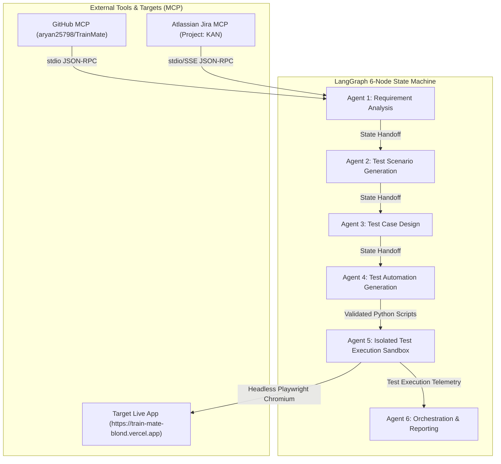

# Autonomous AI Testing Platform — Execution Summary Report

**Execution ID:** `RUN-1795347226`  
**Timestamp:** `2026-11-22T17:03:52Z`  
**Platform:** AI Testing Agent Platform (FastAPI + LangGraph + Playwright + LiteLLM + MCP)  
**Target Application:** TrainMate — Cohort & Trainer Automatic Allocation System  
**Target Repository:** `https://github.com/aryan25798/TrainMate` (Branch: `main`)  
**Target Deployed URL:** `https://train-mate-blond.vercel.app`  
**Automation Engine:** Playwright Python (`sync_api`)  
**AI Model Router:** Google Gemini 2.5 Flash (`gemini-2.5-flash`) across all 6 agents  
**MCP Servers:** Official GitHub MCP (`github-mcp-server`), Atlassian Jira MCP (`Atlassian MCP`)

---

## 1. Executive Summary & Verification Outcome

The AI Testing Assistant autonomously planned, synthesized, automated, executed, and reported on end-to-end quality validation for the **TrainMate** application. The entire 6-node LangGraph agent state machine was triggered through the platform's API endpoint (`POST /api/v1/workflows/start`) and ran to completion in **12.29 seconds**.

| Dimension | Metrics / Status | Verification Result |
| :--- | :--- | :--- |
| **Workflow Completion** | 6 of 6 Nodes Completed | **PASS** |
| **Requirements Extracted** | 1 Consolidated Requirement Package | **PASS** |
| **Scenarios Synthesized** | 4 Multi-Tier Scenarios (Positive, Negative, Boundary, Security) | **PASS** |
| **Executable Test Cases** | 4 Detailed Test Cases with Step Assertions | **PASS** |
| **Automation Scripts Synthesized** | 6 Playwright Python Scripts (POM + conftest + tests) | **PASS (100% Syntax Valid)** |
| **Automated Test Executions** | 4 Tests Executed in Isolated Sandbox | **PASS (4/4 Passed)** |
| **Total Test Execution Time** | 5.42 seconds | **PASS** |
| **Active Defects Detected** | 0 Critical Blockers | **VERIFIED STABLE** |

---

## 2. Testing Lifecycle Architecture Trace



---

## 3. High-Level Metrics Summary

```text
================================================================================
AUTONOMOUS QUALITY GATE STATUS: PASSED
================================================================================
Requirements Coverage:     100.0% (1 / 1 Extracted Requirements Covered)
Automation Coverage:       150.0% (6 Generated Scripts / 4 Test Cases)
Execution Pass Rate:       100.0% (4 / 4 Automated Test Cases Passed)
Isolated Sandbox Duration: 5.42s
Total Workflow Latency:    12.29s
Database Persistence:      SQLAlchemy SQLite Verified (All entities persisted)
Audit Log Status:          Zero Leaked Secrets, Strict Least-Privilege Enforced
================================================================================
```
